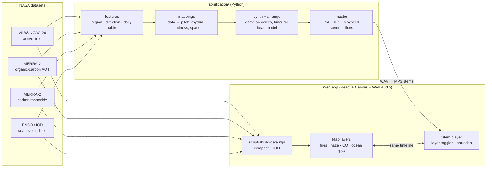
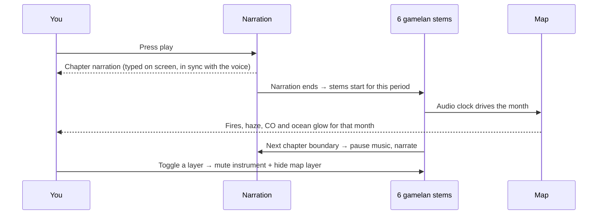

<div align="center">


# Swara Bara

**Listening to Indonesia's wildfires, 2018–2025**

*An accessible data sonification. Eight years of NASA satellite data, played by a Sundanese gamelan.*

NASA Space Apps Challenge · **The Earth Information Jukebox**

[](https://www.spaceappschallenge.org/)
[](https://react.dev/)
[](https://www.typescriptlang.org/)
[](https://vite.dev/)
[](sonification/gamelan_sonification/)
[](#-accessibility)

**[How it sounds](#-the-sonification)** · **[The data](#-nasa-data)** · **[Run it](#-run-it-yourself)**

</div>

---

> Between 2018 and 2025, NASA's VIIRS instrument recorded **1,115,948 fire detections** across Indonesia.
> Swara Bara turns every one of them into sound. Each glowing dot on the map is a fire seen from orbit, and each
> note is a fire too. Smoke, carbon monoxide and the ocean climate that sets the fire season join in as more
> instruments of a gamelan ensemble. You can follow the whole story by ear alone.

<table>
<tr>
<td width="33%" valign="top">

### 🔥 See it
A full-bleed map of Indonesia: real fire detections glow and fade month by month, haze drifts where aerosol is high,
purple contours trace carbon monoxide, and the edges of the map light up with El Niño and the Indian Ocean Dipole.

</td>
<td width="33%" valign="top">

### 🎶 Hear it
Six gamelan stems synthesised from the data: **peking, panerus, bonang, jenglong, rebab and goong**. Switch any
data layer off and its instrument goes quiet and its map layer disappears.

</td>
<td width="33%" valign="top">

### ♿ Feel it without seeing it
An audio and screen-reader mode with spoken narration, monthly map summaries, and full keyboard control. The whole
story works without a screen.

</td>
</tr>
</table>

## Contents

- [The challenge](#-the-challenge)
- [How it works](#-how-it-works)
- [NASA data](#-nasa-data)
- [The sonification](#-the-sonification)
- [The web experience](#-the-web-experience)
- [Accessibility](#-accessibility)
- [Run it yourself](#-run-it-yourself)
- [Project structure](#-project-structure)
- [Limitations and honesty notes](#-limitations-and-honesty-notes)
- [Team and credits](#-team-and-credits)

---

## 🌏 The challenge

Indonesia's peatland fires are one of the planet's largest seasonal sources of smoke and carbon. In 2019 the
national disaster agency counted 919,516 people with acute respiratory infections. Satellites measure all of it,
but those measurements usually end up as charts, and charts shut out anyone who can't see them and leave most other
people unmoved.

**Our goal:** make eight years of NASA Earth-observation data something you can *listen to*, so the rise and fall of
the fires, the haze that follows them, and the ocean cycles behind them can be heard, felt and understood by
everyone. That includes blind and low-vision audiences.

This project answers the NASA Space Apps challenge **The Earth Information Jukebox**: it turns NASA Earth data into
sound, as a jukebox of eight songs. There is one song for Indonesia and one for each of its seven regions, and
each song tells its own fire story.

---

## 🧭 How it works



The **same four datasets** feed both halves. The Python pipeline *composes* the music. The web app *draws* the
same numbers and plays the stems in sync, so what you see and what you hear always describe the same month.

---

## 🛰 NASA data

| Layer | Dataset | What it tells us | Time step | Coverage |
|---|---|---|---|---|
| 🔥 **Wildfire** | [FIRMS](https://firms.modaps.eosdis.nasa.gov/) VIIRS NOAA-20 375 m active fires | Where each fire burned, how hot (`bright_ti4`, `bright_ti5`) and how strong (`frp`, MW) | per detection | Apr 2018 – Dec 2025, 1.1 M detections |
| 🌫 **Aerosol** | [MERRA-2](https://gmao.gsfc.nasa.gov/reanalysis/MERRA-2/) organic-carbon aerosol optical thickness | Smoke haze, per region (`norm`, `lognorm`, `anomaly_norm`) | monthly | 2018 – 2025, Indonesia + 7 regions |
| 🟣 **CO** | MERRA-2 carbon monoxide | Gas released by burning, which lingers longer than smoke | monthly | Indonesia, Sumatra, Kalimantan, Papua |
| 🌊 **El Niño + IOD** | ENSO and Indian Ocean Dipole indices from NASA sea-level data | The ocean cycles that make dry seasons drier | weekly | 1993 – 2026 |

<details>
<summary><b>How the web app prepares the data</b> (click to expand)</summary>

`npm run data` runs [`scripts/build-data.mjs`](scripts/build-data.mjs), which reads `dataset_source/` and writes
compact JSON to [`src/data/real/`](src/data/real/):

- **Fires:** every VIIRS detection is assigned to a province polygon and counted per month. Each drawn dot is one
  real detection standing in for 60, chosen by unbiased random sampling, so all ~1.1 M detections still count
  toward the monthly totals. Output: ~18,600 dots, about 310 KB gzipped, loaded as a separate chunk.
- **Aerosol and CO:** per-region monthly values. They are painted over each region's land on a 0.625° × 0.5° grid
  and fade softly out to sea.
- **ENSO / IOD:** the weekly values are averaged per month.

</details>

<details>
<summary><b>What the data shows</b>: yearly VIIRS detections per region</summary>

| Region | 2018* | 2019 | 2020 | 2021 | 2022 | 2023 | 2024 | 2025 |
|---|---:|---:|---:|---:|---:|---:|---:|---:|
| Kalimantan | 58,336 | **164,315** | 20,761 | 17,135 | 16,152 | 81,808 | 32,802 | 28,588 |
| Sumatra | 26,148 | **131,201** | 14,876 | 13,078 | 12,990 | 46,863 | 20,606 | 20,967 |
| Bali & Nusa Tenggara | 22,750 | 31,165 | 18,558 | 14,542 | 10,309 | 28,463 | 18,475 | 14,830 |
| Papua | 21,795 | 15,614 | 8,435 | 2,840 | 2,763 | **23,313** | 4,781 | 1,684 |
| Sulawesi | 11,542 | 22,450 | 5,840 | 4,304 | 4,047 | 16,129 | 6,181 | 6,186 |
| Java | 10,629 | 17,709 | 5,113 | 4,172 | 2,867 | 11,955 | 8,093 | 3,105 |
| Maluku | 4,268 | 8,497 | 2,987 | 1,518 | 1,209 | 6,095 | 2,240 | 1,867 |

\* VIIRS NOAA-20 detections start in April 2018. The 2019 crisis (strong positive IOD) and the 2023 El Niño stand
out clearly. The La Niña years 2020–2022 are quiet. Counts are from the web app's province-polygon assignment.

</details>

---

## 🎼 The sonification

The music is composed by a reproducible Python pipeline in
[`sonification/gamelan_sonification/`](sonification/gamelan_sonification/). It renders a **binaural piece for a
Sundanese degung ensemble plus rebab**, in A-flat minor pentatonic, for Indonesia and each of its 7 regions.

### Who plays what

| Instrument | Data | Pitch | Rhythm / duration | Loudness | Space |
|---|---|---|---|---|---|
| **Peking** | VIIRS fires | `bright_ti4` | more fires → faster (1–10 notes/s) | `frp` (−18…0 dB) | 🎧 binaural: where the fire is |
| **Panerus** | VIIRS fires | `bright_ti5` (an octave lower) | 0.6–6 notes/s | `frp` | 🎧 binaural |
| **Bonang** | MERRA-2 AOT | `norm` | note length from `lognorm` | `anomaly_norm` (±12 dB) | centre |
| **Rebab** | MERRA-2 CO | sustained on the root, Ab3 | more CO → faster bowing (0.25 → 6 bow changes/s) | more CO → louder | centre |
| **Jenglong** | ENSO + IOD | ENSO (El Niño higher, La Niña lower) | 0.7 strokes/s | IOD (−9…+12 dB) | centre |
| **Goong** | time | Ab2 | marks every new year | constant | centre |

> 💡 **El Niño and IOD share one instrument.** They are switched together in the app: turning one off silences the
> jenglong, so the other turns off too.

<details>
<summary><b>🎧 Binaural fire positions</b>: why you should listen on headphones</summary>

The listener stands at the centre of the region, **facing north**. Every peking and panerus note is one real fire
detection, placed at that fire's direction and distance using a spherical-head model (Brown & Duda 1998). The model
covers interaural time and level differences, distance attenuation, air absorption, and a duller sound behind you.
A short **compass** of eight rising notes (N → NE → … → NW) opens the piece so your ears can calibrate.

Headphones separate left from right well, but front from back less well, so fires due south can sometimes sound
in front of you.

</details>

<details>
<summary><b>🎹 Pitch space</b>: six octaves of A-flat minor pentatonic</summary>

```
degree d = 5·o + s        o = octave above B1, s = 0..4  (B, Db, Eb, Gb, Ab)
range    = B1 61.7 Hz … B7 3951 Hz  (degrees 0 … 30)

jenglong  0–10   B1 – B3      bonang   10–20   B3 – B5
panerus  15–25   B4 – B6      peking   20–30   B5 – B7
gong     Ab2 103.8 Hz         rebab    Ab3 207.7 Hz (root)
```

National scales (1st–99th percentile over all detections) are shared by every region, so the same fire
temperature gives the same note in Sumatra and in Papua.

</details>

<details>
<summary><b>⏱ Time axis</b>: eight years in under two and a half minutes</summary>

- About **0.049 s of audio per day**. The full piece runs 2:27 per region.
- Note onsets come from a continuous rate integrator, with no bars or grid, so density changes smoothly.
- Melodies follow a *soft-continuity walk*. Each note is a real detection, but closer pitches are more likely, so
  lines move mostly stepwise (median step 2 semitones).
- **Slices** (`--slices`) re-render each period from the same score, so every note is sample-identical to the full
  piece. They are mastered with the full piece's gain, so a quiet year stays quiet. The web app plays these slices
  between narration chapters:
  - Indonesia: 2018 · 2019 · 2020–2022 · 2023 · 2024 · 2025
  - Regions: 2018–2020 · 2021–2023 · 2024–2025

</details>

<details>
<summary><b>🔊 Synthesis and mastering</b></summary>

All voices are synthesised in numpy, with no samples:

- **Peking and panerus:** FM.
- **Bonang, jenglong and gong:** modal kettle models with *ombak* beating.
- **Rebab:** harmonic model with vibrato, body resonances and bow-change noise.

The mix gets a 2.2 s synthetic hall reverb, stereo-linked compression (which preserves binaural cues),
normalisation to −14 LUFS, and a −1 dBFS limiter. Output is 16-bit / 44.1 kHz WAV: one combined mix plus **6 stems
aligned sample for sample**.

</details>

<details>
<summary><b>✅ Built-in checks</b>: does the music really follow the data?</summary>

Every run prints a round-trip analysis (`--report` writes JSON):

- **Temporal alignment:** each data peak (fires, AOT, CO, ENSO, IOD) must be *heard* within 3 weeks of its data
  date. All checks pass for every region.
- **Binaural fidelity:** the measured left/right energy correlates with the true fire directions at r = 0.76–0.96.
- **Pitch:** every note lies inside A1–C8 and in the scale.
- **Reproducibility:** every random choice is seeded, so the same inputs give byte-identical files.

</details>

📖 The full specification (every formula, constant and design decision) is in
[**`FRAMEWORK.md`**](sonification/gamelan_sonification/FRAMEWORK.md).

---

## 🗺 The web experience



| On the map | Driven by |
|---|---|
| Glowing dots (size = FRP, colour = brightness), burn scars and sparks | VIIRS detections |
| Drifting warm-grey haze | MERRA-2 organic-carbon AOT |
| Purple contour lines (85 / 105 / 130 / 160 ppb) | MERRA-2 CO |
| Orange or blue glow at the west (Indian Ocean) and east (Pacific) edges | IOD and ENSO |
| Level meters beside each layer switch | the same values the instruments play |

**Eight songs:** Indonesia (7 narrated chapters) plus a three-chapter story for each region: Sumatra, Kalimantan,
Java, Sulawesi, Bali & Nusa Tenggara, Maluku and Papua. Each region's story is told through real events such as
the 2018 Asian Games haze, the 2019 crisis, and the 2023 fires on Mount Arjuno and Mount Merbabu.

<details>
<summary><b>⌨️ Keyboard shortcuts</b></summary>

| Key | Action |
|---|---|
| <kbd>Space</kbd> | Play or pause |
| <kbd>←</kbd> <kbd>→</kbd> | Back or forward one month |
| <kbd>1</kbd> – <kbd>7</kbd> | Open a region: Sumatra, Kalimantan, Java, Sulawesi, Bali & Nusa Tenggara, Maluku, Papua |
| <kbd>Esc</kbd> | Back to Indonesia, or close a dialog |
| <kbd>N</kbd> | Repeat the latest narration |
| <kbd>?</kbd> | Open the guide |

</details>

---

## ♿ Accessibility

Accessibility is the starting point of the design, not an add-on.

- **Two modes from the first screen:** *Audio / screen reader* or *Visual*. You can switch any time in Settings.
- **Everything is announced:** chapter narration, a spoken map summary every January and at seasonal peaks, region
  stats when you move across the map with the arrow keys, and layer on/off changes.
- **Full keyboard control.** A roving-focus region map and switches with `role="switch"` and live values.
- **Screen readers get whole sentences.** The on-screen typing animation is visual only, and the full chapter text
  is exposed to assistive technology at once.
- **`prefers-reduced-motion` is respected:** no typing, no drifting smoke, no sparks, and a static map that redraws
  per month.
- **Built-in voice** (browser speech synthesis) for visitors without a screen reader.

---

## 🚀 Run it yourself

### Web app

```bash
npm install
npm run dev        # http://localhost:5173
```

| Script | What it does |
|---|---|
| `npm run dev` | Development server |
| `npm run build` | Typecheck and production build to `dist/` |
| `npm run test` | Unit tests (Vitest): data, meters, sound manifest, narration typing |
| `npm run lint` | ESLint, including `jsx-a11y` |
| `npm run data` | Rebuild `src/data/real/*.json` from `dataset_source/` (~1 min) |
| `npm run geo` | Rebuild the province GeoJSON |

<details>
<summary><b>Rebuilding the data</b></summary>

The datasets are included in `dataset_source/`:

```
dataset_source/
├── VIIRS-cleaned-2018-2025.zip            # viirs_clean/viirs_n20_indonesia_<YEAR>_clean.csv
├── merra2_aot_oc_indonesia_monthly.csv
├── co_merra2_monthly.csv
└── enso_iod.csv
```

Then run `npm run data`. It needs `unzip` on your `PATH`.

</details>

### Sonification

```bash
cd sonification/gamelan_sonification
pip install -r requirements.txt            # numpy, scipy, pandas · Python ≥ 3.10

# put the datasets in data/ (see data/README.md), or pass --viirs / --aot / --co / --enso
python run_all.py --region all --slices --zip       # all 8 areas, full piece + slices
python run_all.py --region Sumatra --report         # one region + JSON check report
```

<details>
<summary><b>All options</b></summary>

```
python run_all.py --region {Indonesia,Sumatra,Kalimantan,Jawa,Sulawesi,Maluku,Bali_NusaTenggara,Papua,all}
                  [--start 2018-04-01] [--end 2025-12-31]
                  [--segment year|quarter|month]           # when the goong strikes
                  [--max-duration 150]                     # seconds
                  [--spatial-smoothing off|light|strong]
                  [--slices | --sliced-only] [--zip] [--report] [--out output]
                  [--viirs PATH] [--aot PATH] [--co PATH] [--enso PATH]
```

The first run builds a region cache (~20 s). Each region then takes ~35–40 s, or ~55–75 s with `--slices`, and
uses ~3.5 GB of memory. On machines with less than 8 GB, render one region at a time.

</details>

<details>
<summary><b>From WAV stems to the web player</b></summary>

The web app streams the sliced stems as MP3 from:

```
public/audio/stems/<song>/<slice>/{peking,panerus,bonang,jenglong,rebab,gong}.mp3
public/audio/narration/<song>_<chapter>.mp3
```

`<song>` is `indonesia`, `sumatra`, `kalimantan`, `java`, `sulawesi`, `bnt`, `maluku` or `papua`. `<slice>` matches
[`src/sound/manifest.ts`](src/sound/manifest.ts). For example, convert one slice with ffmpeg:

```bash
ffmpeg -i Sumatra_2018-2020_1_peking.wav -b:a 192k public/audio/stems/sumatra/2018-2020/peking.mp3
```

The engine keeps all six stems on one Web Audio clock, mutes them per layer, and drives the map's playhead from
that clock. Regions without stems fall back to a silent timeline, so the map still plays.

</details>

---

## 📁 Project structure

<details open>
<summary><b>Repository layout</b></summary>

```
.
├── src/
│   ├── App.tsx                 # timeline, narration ↔ stems hand-off, shortcuts, announcements
│   ├── components/             # SoundLayers (switches + meters), NarrationPanel (typing), Legend, Player, ModeGate, Tour…
│   ├── map/                    # MapView + canvas layers: fireLayer, scarLayer, glowLayer, smokeLayer, coLayer
│   ├── data/
│   │   ├── real/               # generated JSON from the NASA datasets
│   │   ├── generate.ts         # fire songs from VIIRS
│   │   ├── aerosol.ts · co.ts · climate.ts
│   │   ├── narration.json      # chapter scripts
│   │   └── geo/                # province + neighbour outlines
│   ├── sound/                  # audioEngine (Web Audio stems + narration), manifest, meters
│   ├── a11y/                   # live-region announcer, speech synthesis
│   └── timeline/               # playback clock reducer
├── scripts/
│   ├── build-data.mjs          # NASA datasets → src/data/real/*.json
│   └── build-geo.mjs
├── sonification/
│   └── gamelan_sonification/   # Python composer: fetch → features → mappings → synth/arrange → master → analysis
│       └── FRAMEWORK.md        # full specification
└── public/audio/               # narration + sliced gamelan stems (MP3)
```

</details>

---

## ⚖️ Limitations and honesty notes

- **Aerosol and CO are regional monthly means, not grids.** On the map, each region's real value is spread evenly
  over its land, so haze does not cluster around individual fires.
- **CO regional coverage:** Java, Sulawesi, Bali & Nusa Tenggara and Maluku use the Indonesia-wide CO series,
  because the source file has no column for them. This applies in both the app and the sonification.
- **Smoke drift direction** on the map follows a fixed seasonal monsoon pattern and is purely visual. The *amount*
  of haze is the data.
- **Burned hectares and respiratory-infection totals** on the closing screen are approximate yearly figures, not
  satellite data. They are spread over months and regions by each one's share of real fire
  detections.
- **Region boundaries differ slightly:** the sonification uses latitude/longitude rules, and the web app uses
  province polygons.
- **Time compression:** at ~0.05 s per day, fire bursts shorter than about two weeks blur together in the music.

---

## 👥 Team and credits

**Swara Bara**, made for the NASA Space Apps Challenge: *The Earth Information Jukebox*.

| Team |
|---|
| Noumisyifa Nabila Nareswari |
| Mayla Yaffa Ludmilla |
| Muhammad Rafly Indraprasta |
| Andrew Isra Saputra DB |

**Data:** NASA FIRMS (VIIRS NOAA-20 active fires) · NASA GMAO MERRA-2 (aerosol, carbon monoxide) · NASA sea-level
ENSO and IOD indices.

**Geography:** Indonesian province outlines from
[superpikar/indonesia-geojson](https://github.com/superpikar/indonesia-geojson), and neighbouring land from
[world-atlas](https://github.com/topojson/world-atlas).

**Sound:** Sundanese degung instruments, synthesised in code. Binaural model after Brown & Duda (1998), *A structural
model for binaural sound synthesis*.

<div align="center">

*Swara* means voice and *bara* means embers. This project gives the embers a voice.

</div>
